<u>**Informe de laboratorio 11: Extracción de características de la señal ECG**</u>

Integrantes: Julio Alonso Vásquez Tantaleán, Mariel Andrea Brachowicz Suarez, Abigail Alcazar Vargas, Ana Paula Vela Velasquez

<u>Resumen</u>

En este laboratorio trabajamos con el notebook LAB11_ECG_Extraccion_Caracteristicas, que tiene todo el procedimiento para pasar de una señal ECG a una tabla de características con la que un algoritmo puede decidir en qué condición fisiológica se registró cada latido.

En vez de usar datos de ejemplo, usamos nuestros propios registros del laboratorio de ECG, tomados con el BITalino en 4 condiciones (basal, hiperventilación, hipoventilación y después de actividad aeróbica) y en 3 derivaciones (DI, DII y DIII), es decir, 12 archivos. El notebook tiene dos partes: en la Parte A revisamos la calidad de los datos y elegimos la derivación, y en la Parte B extrajimos 24 características por latido y comparamos los clasificadores. Al final se generó el archivo caracteristicas_ecg.csv, con 186 latidos y 24 características.

<u>**1. Fundamentos**</u>

Un latido dura unos 600 ms, así que a 1000 Hz tiene 600 números. Es mucha información y muy repetida. Extraer características es resumir ese latido en unos pocos números que tengan sentido, como la altura del pico R, el tiempo desde el latido anterior o en qué frecuencias está su energía. Con esos números un clasificador aprende a decir a qué grupo pertenece cada latido.

Las derivaciones del triángulo de Einthoven miden la diferencia de potencial entre dos electrodos: DI entre el brazo izquierdo y el derecho (LA − RA), DII entre la pierna izquierda y el brazo derecho (LL − RA) y DIII entre la pierna izquierda y el brazo izquierdo (LL − LA). Cada derivación mira el corazón desde un ángulo distinto, por eso el mismo latido tiene una forma diferente en cada una.

Un detalle importante es que con el BITalino las derivaciones no se graban al mismo tiempo, sino una después de otra, con algunos minutos de diferencia. Esto se notó bastante en los resultados, como se explica más adelante.

<u>**2. Parte A: conociendo nuestros datos**</u>

*Lectura de los archivos*

El notebook lee la cabecera de cada archivo de OpenSignals para sacar la frecuencia de muestreo, la resolución y el canal, y convierte los valores del ADC a milivoltios con la fórmula del sensor ECG del BITalino (VCC = 3.3 V y ganancia de 1100). Los 12 archivos salieron con 1000 Hz, 10 bits y una duración de entre 32.1 y 37.6 s, así que ninguno dura menos de 30 s.

También revisa dos problemas de adquisición. No hubo paquetes perdidos por Bluetooth en ningún archivo. Solo el registro de actividad aeróbica en DIII tuvo saturación, con 129 muestras pegadas al límite del ADC.

Mirando la hora de cada archivo se ve que las derivaciones se grabaron en distinto orden: DI → DII → DIII en basal e hipoventilación, y DIII → DII → DI en hiperventilación y actividad aeróbica.

*Primer vistazo a las 12 señales*

  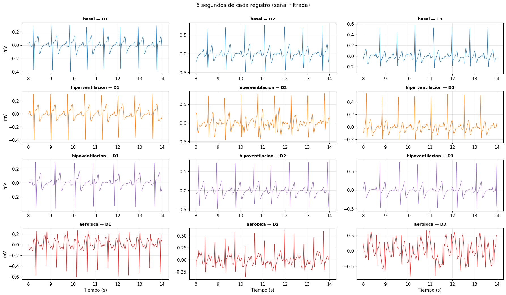 
  <em>Figura 1. 6 segundos de cada registro ya filtrado. Filas: condiciones. Columnas: derivaciones.</em>

En la Figura 1 se ve que en DII el QRS es claramente positivo. En DI es negativo en las cuatro condiciones, y en DIII es positivo excepto en actividad aeróbica, donde sale invertido y la señal se ve mucho menos estable. En actividad aeróbica los latidos están bastante más juntos, sobre todo en DIII, que fue la primera derivación que se grabó después del ejercicio. También se ven señales más ruidosas en hiperventilación DII y DIII, y en actividad DIII.

*Control de calidad automático*

Después se pasaron los 12 archivos por el pipeline completo. Si el QRS apunta hacia abajo, la señal se invierte (se decide con la asimetría de la señal). Luego se detectan los picos R y se revisan los intervalos RR: un RR que se aleja más del 35 % de la mediana de sus vecinos se marca como anómalo, porque suele ser un artefacto contado como latido o un latido que no se detectó.

| Archivo | QRS original | Latidos detectados | Latidos válidos | % RR anómalos | Saturadas | Estado |
|---|---|---:|---:|---:|---:|:---:|
| basal D1 | negativo → invertido | 47 | 45 | 0.0 | 0 | ✅ |
| hiperventilación D1 | negativo → invertido | 41 | 39 | 0.0 | 0 | ✅ |
| hipoventilación D1 | negativo → invertido | 35 | 33 | 0.0 | 0 | ✅ |
| aeróbica D1 | negativo → invertido | 71 | 69 | 0.0 | 0 | ✅ |
| basal D2 | positivo | 39 | 37 | 0.0 | 0 | ✅ |
| hiperventilación D2 | positivo | 43 | 41 | 0.0 | 0 | ✅ |
| hipoventilación D2 | positivo | 39 | 37 | 0.0 | 0 | ✅ |
| aeróbica D2 | positivo | 73 | 68 | 2.8 | 0 | ⚠️ |
| basal D3 | positivo | 40 | 38 | 0.0 | 0 | ✅ |
| hiperventilación D3 | positivo | 28 | 12 | 33.3 | 0 | ❌ |
| hipoventilación D3 | positivo | 44 | 42 | 0.0 | 0 | ✅ |
| aeróbica D3 | negativo → invertido | 96 | 88 | 3.2 | 129 | ❌ |

Tres archivos tuvieron problemas. En aeróbica DII hubo un solo RR anómalo, probablemente por un artefacto de movimiento. Aeróbica DIII quedó como problemático por la saturación y el ruido de movimiento después del ejercicio. El peor fue hiperventilación DIII, con un tercio de los RR anómalos.

  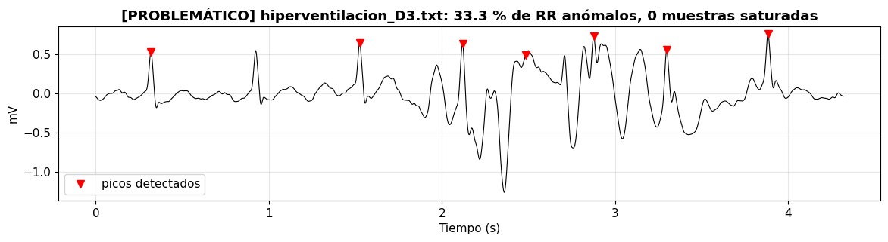 
  <em>Figura 2. Inicio del registro de hiperventilación en DIII, con los picos detectados.</em>

En la Figura 2 se ve qué pasó: al inicio hay un artefacto de movimiento grande (entre 2 y 3.5 s) y, además, el detector se saltó varios QRS normales, por ejemplo el que está cerca de 0.9 s. Como el umbral del detector se calcula con el percentil 99 de toda la señal, el artefacto lo subió tanto que los latidos normales ya no lo alcanzaban. Por eso salieron intervalos RR de hasta 4 s y solo 12 latidos válidos.

*Frecuencia cardiaca*

La frecuencia cardiaca se calculó como FC = 60 / RR, usando solo los RR que no son anómalos.

| Condición | DI (lpm) | DII (lpm) | DIII (lpm) |
|---|---:|---:|---:|
| Basal | 76.9 | 72.2 | 74.5 |
| Hiperventilación | 74.2 | 80.0 | 82.5 |
| Hipoventilación | 65.3 | 72.1 | 70.5 |
| Aeróbica | 127.7 | 133.0 | 156.3 |

  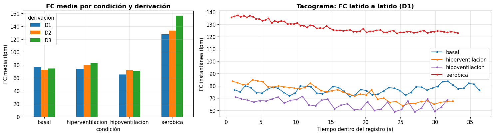 
  <em>Figura 3. Izquierda: FC media por condición y derivación. Derecha: FC latido a latido en DI (tacograma).</em>

Tomando DI como referencia, el orden fue aeróbica > basal > hiperventilación > hipoventilación. Que la FC suba con el ejercicio y sea la más baja al retener la respiración tiene sentido. Lo que no esperábamos es que basal e hiperventilación salieran casi iguales (76.9 y 74.2 lpm), así que en nuestro registro la hiperventilación no subió la FC de forma sostenida.

En el tacograma de la Figura 3 se ve que la FC no es constante dentro de cada registro. En aeróbica baja de unos 136 a 123 lpm en 30 segundos, porque el corazón se va recuperando del ejercicio. En hiperventilación pasa de 82.7 lpm al inicio a 66.8 lpm al final, y en hipoventilación también baja poco a poco.

La FC en aeróbica fue muy distinta entre derivaciones: 156.3 lpm en DIII, 133.0 en DII y 127.7 en DI. Eso coincide con el orden de grabación: DIII se tomó justo al terminar el ejercicio y DI unos 4 minutos después, cuando la FC ya había bajado. Es decir, cada derivación de la misma condición en realidad es un momento fisiológico distinto.

*Elección de la derivación*

En la Parte B se trabaja con una sola derivación a la vez. Si se mezclaran, el clasificador aprendería a reconocer la derivación (porque la forma del latido cambia mucho entre ellas) y no la condición. Elegimos DI porque tiene las cuatro condiciones completas y los cuatro archivos pasaron el control de calidad sin ningún RR anómalo. Su QRS es negativo, pero se invierte de forma consistente en las cuatro condiciones. DII también tenía buena calidad, pero con un RR anómalo en aeróbica, y DIII tenía los dos archivos problemáticos.

<u>**3. Parte B: preprocesamiento y detección de latidos**</u>

*Filtrado*

La señal cruda trae tres problemas: la deriva de la línea base por la respiración (por debajo de 0.5 Hz), la interferencia de la red eléctrica (60 Hz) y el ruido muscular y electrónico (por encima de unos 40 Hz). Para quitarlos se usó un pasa-banda Butterworth de 0.5 a 40 Hz y un notch en 60 Hz. Los dos se aplicaron hacia adelante y hacia atrás (filtfilt), para no mover las ondas en el tiempo. Esto es importante porque si el pico R se desplaza, todas las medidas de tiempo salen mal.

  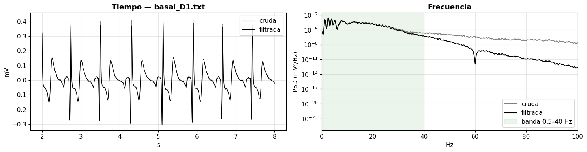 
  <em>Figura 4. Registro basal DI antes y después de filtrar, en el tiempo (izquierda) y en frecuencia (derecha).</em>

En la Figura 4 la señal filtrada queda centrada en cero y sin ondulaciones lentas, y la forma de P, QRS y T se conserva. En el espectro, la potencia cae fuera de la banda de 0.5 a 40 Hz y dentro de ella las dos curvas coinciden, o sea que el filtro no deformó la parte útil.

*Detección de picos R con Pan-Tompkins*

Para analizar latidos primero hay que encontrarlos, y el punto más fácil es el pico R. El algoritmo de Pan y Tompkins (1985) resalta lo que hace único al QRS (cambios rápidos y grandes) y apaga lo lento (ondas P y T). Tiene seis pasos:

1. Pasa-banda de 5 a 15 Hz, que es donde está la energía del QRS.
2. Derivada, porque el QRS tiene las pendientes más empinadas del latido.
3. Elevar al cuadrado, para que todo sea positivo y las pendientes grandes resalten más.
4. Integración con una ventana móvil de 150 ms, que convierte cada QRS en una sola "joroba".
5. Umbral y periodo refractario de 250 ms, porque no puede haber dos latidos en menos de 250 ms (más de 240 lpm).
6. Buscar el máximo del ECG filtrado a ±100 ms de cada joroba, que es el pico R.

  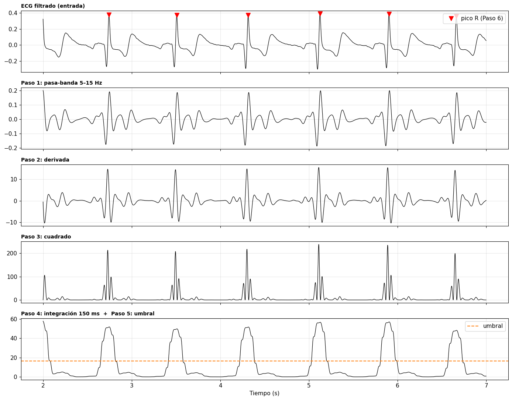 
  <em>Figura 5. Los pasos del algoritmo de Pan-Tompkins sobre el registro basal DI.</em>

En la Figura 5 se ve cómo en el paso 1 las ondas P y T casi desaparecen, en el paso 3 solo quedan picos positivos y los del QRS son mucho más grandes, y en el paso 4 cada latido es una sola joroba que se puede contar con un umbral. La derivada es la que más ayuda a separar el QRS de la onda T: la onda T puede ser alta, pero es ancha y lenta, así que su derivada es pequeña. En los cuatro registros de DI todos los triángulos cayeron sobre picos R y no vimos falsos positivos ni falsos negativos.

*Segmentación en latidos*

Alrededor de cada pico R se recortó una ventana de 200 ms antes y 400 ms después. Cada recorte es un latido y una fila de la tabla. Se quitaron el primer y el último latido de cada registro (no tienen RR a ambos lados) y los latidos con RR anómalo. En total quedaron 186 latidos: 45 de basal, 39 de hiperventilación, 33 de hipoventilación y 69 de aeróbica.

  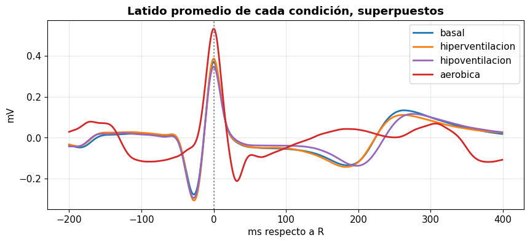 
  <em>Figura 6. Latido promedio de cada condición en DI (ya invertido).</em>

En la Figura 6 basal, hiperventilación e hipoventilación casi se superponen. En hipoventilación la onda T aparece un poco más tarde (276 ms después de R, contra unos 262 ms en basal e hiperventilación), lo que cuadra con que la FC era más baja. El latido aeróbico es muy distinto: el pico es más alto, la onda T llega más tarde (291 ms) y antes del R hay una onda que no aparece en las demás.

Revisando mejor, esa onda antes del R en aeróbica no es parte del mismo latido. Con una FC de 128 lpm el RR es de unos 470 ms, así que 200 ms antes del R equivalen a 270 ms después del R anterior, justo donde está la onda T del latido previo. Es decir, la ventana de −200/+400 ms es demasiado larga para FC altas y el latido anterior "se mete" en el recorte. Esto afecta varias medidas morfológicas de aeróbica, como se explica en la siguiente sección.

<u>**4. Extracción de características**</u>

Siguiendo el artículo base, cada latido se describió con 24 características separadas en cinco familias:

| Familia | Qué responde | Características |
|---|---|---|
| Ritmo | ¿Cuándo llegó el latido? | RR previo, RR siguiente, FC instantánea |
| Morfológicas | ¿Qué forma tiene? | Amplitudes de P, Q, R, S y T, duración Q–S, tiempo R→T |
| Estadísticas | ¿Cómo se reparten sus valores? | Media, mediana, desviación estándar, percentiles 25 y 75 |
| Orden superior (HOS) | ¿Es simétrico? ¿Es puntiagudo? | Asimetría y curtosis |
| Frecuencia | ¿En qué frecuencias está su energía? | FFT: frecuencia dominante, potencia 0.5–40 Hz, fracción 5–15 Hz. Wavelet: energía de 4 niveles |

*Ritmo y morfología*

Las medidas morfológicas son como medir con regla sobre el papel del electrocardiógrafo. Todas las amplitudes se miden respecto a la línea isoeléctrica, que se estima como el promedio entre −100 y −60 ms (el segmento PR). Cada onda se busca en una ventana fija: P entre −200 y −80 ms, Q entre −60 y 0 ms, S entre 0 y +80 ms, y T entre +150 y +400 ms.

  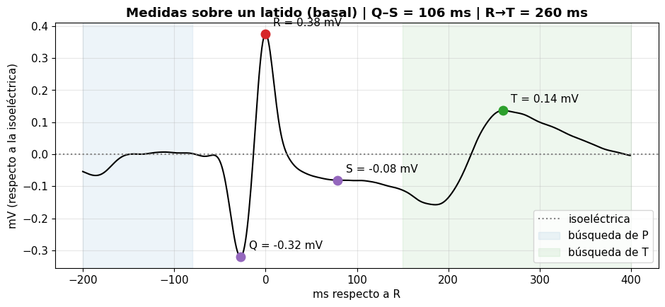 
  <em>Figura 7. Puntos Q, R, S y T medidos sobre un latido basal de DI.</em>

En el latido de ejemplo de la Figura 7 salió un RR previo de 810 ms (74 lpm), R = 0.375 mV, Q = −0.320 mV, S = −0.081 mV, T = 0.137 mV, una duración Q–S de 106 ms y un tiempo R→T de 260 ms.

Algo que notamos es que en DI la Q salió casi tan grande como la R. Esto pasa porque DI se invirtió: en la señal original el latido tenía un pico pequeño hacia arriba seguido de uno grande hacia abajo, y al invertirla el pico grande pasa a ser la "R" y el pequeño pasa a ser la "Q". O sea que en DI los nombres Q y R no corresponden exactamente a las ondas anatómicas, que es justo lo que el notebook advertía sobre invertir la señal.

*Estadísticas, HOS y frecuencia*

Las estadísticas tratan los 600 valores del latido como si fueran notas de un examen. La asimetría y la curtosis son estadísticas de tercer y cuarto orden: un R alto y estrecho da asimetría positiva, y un pico muy agudo con el resto plano da curtosis alta.

Para la parte espectral se calculó la FFT de cada latido y se midió la frecuencia dominante, la potencia total entre 0.5 y 40 Hz y qué fracción de esa potencia cae entre 5 y 15 Hz, la banda del QRS.

  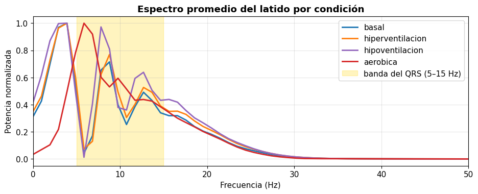 
  <em>Figura 8. Espectro promedio del latido por condición. La franja amarilla es la banda del QRS.</em>

En la Figura 8, basal, hiperventilación e hipoventilación tienen su máximo cerca de 3 a 4 Hz, que corresponde a las ondas lentas (P y T). En aeróbica el máximo se corre a unos 6 Hz y el 61 % de la potencia está en la banda del QRS, contra un 40 a 43 % en las otras condiciones.

*Wavelet*

La FFT dice qué frecuencias hay, pero no en qué parte del latido están. La transformada wavelet discreta (DWT) separa el latido en capas, como un ecualizador, y cada capa conserva la ubicación en el tiempo. Se usó la wavelet Daubechies 4 (db4), que se parece a un QRS, con 6 niveles. La capa cA6 (0 a 7.8 Hz) tiene las ondas lentas P y T, cD6 (7.8 a 15.6 Hz) la parte principal del QRS, cD5 (15.6 a 31 Hz) los bordes rápidos del QRS, y cD4 (31 a 62.5 Hz) casi nada, porque el filtro cortó en 40 Hz. Como característica se usó el porcentaje de la energía total que hay en cada capa.

  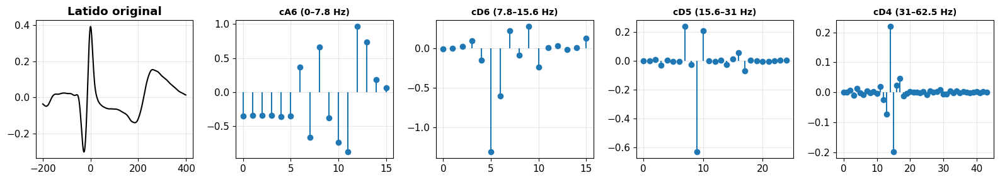 
  <em>Figura 9. Descomposición wavelet de un latido basal.</em>

En el latido de ejemplo, el 61.6 % de la energía quedó en cA6, el 30.5 % en cD6, el 6.6 % en cD5 y solo el 1.3 % en cD4.

*La tabla de características*

Al juntar las cinco familias se obtuvo una tabla de 186 filas (latidos) por 24 columnas (características), más la columna con la clase. Algunos promedios por condición:

| Característica | Basal | Hiperventilación | Hipoventilación | Aeróbica |
|---|---:|---:|---:|---:|
| FC (lpm) | 77.0 | 74.9 | 65.4 | 127.9 |
| amp_P (mV) | 0.007 | 0.011 | 0.016 | 0.197 |
| amp_Q (mV) | −0.292 | −0.325 | −0.304 | 0.010 |
| amp_R (mV) | 0.356 | 0.368 | 0.337 | 0.646 |
| amp_T (mV) | 0.119 | 0.093 | 0.107 | 0.200 |
| Duración Q–S (ms) | 101.4 | 96.8 | 96.0 | 91.1 |
| Tiempo R→T (ms) | 263.4 | 261.5 | 276.1 | 291.1 |
| Asimetría | 0.55 | 0.42 | 0.29 | 1.85 |
| Curtosis | 2.27 | 3.00 | 2.51 | 6.03 |
| Fracción 5–15 Hz | 0.398 | 0.400 | 0.432 | 0.611 |

Aquí se ve el problema de la ventana en aeróbica. La "onda P" de aeróbica salió unas 20 veces más grande que en las demás condiciones (0.197 mV), pero en realidad es la onda T del latido anterior, que cae en la ventana de búsqueda de P. Además, la línea isoeléctrica también se calcula en esa zona contaminada, y por eso la Q de aeróbica salió positiva (0.010 mV), lo cual no tiene sentido como onda Q. Las demás condiciones tienen RR de 780 a 920 ms, así que no tienen este problema.

  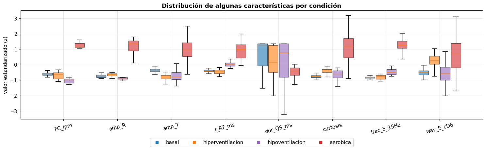 
  <em>Figura 10. Distribución estandarizada de algunas características por condición.</em>

En la Figura 10, las características que mejor separan las condiciones son la FC y la amplitud R, sobre todo para aeróbica. La FC tiene sentido fisiológico por el ejercicio. La amplitud R hay que tomarla con cuidado, porque también cambia con el contacto de los electrodos, la postura y el movimiento, y además en aeróbica está medida respecto a una línea isoeléctrica mal estimada. Las condiciones que más se parecen entre sí en casi todas las características son basal e hiperventilación.

<u>**5. Clasificación**</u>

Se compararon los mismos cinco clasificadores del artículo base:

| Algoritmo | Idea |
|---|---|
| Árbol de decisión (DT) | Hace preguntas de sí o no, como "¿FC > 90?", hasta decidir |
| Regresión logística (LR) | Suma las características con pesos y calcula la probabilidad de cada clase |
| Random Forest (RF) | Entrena muchos árboles distintos y decide por votación |
| KNN (k = 5) | Mira los 5 latidos más parecidos y copia su clase |
| SVM (kernel RBF) | Busca la frontera que deja el mayor margen entre clases |

*Evaluación sin fuga de datos*

Igual que en el laboratorio de EMG, se remarcó mucho la fuga de datos. Dos latidos seguidos son casi idénticos, así que si se mezclan al azar el modelo se entrena con el latido 10 y se evalúa con el 11, que es casi una copia. Para evitarlo, los latidos se agruparon en bloques de 10 s y se usó StratifiedGroupKFold, que manda cada bloque entero a entrenamiento o a prueba y procura que cada pliegue tenga todas las condiciones. Quedaron 16 bloques y 4 pliegues. Como métricas se usaron la exactitud y el F1 macro, que es el promedio del F1 de cada clase y es más justo cuando hay clases con más latidos. Con 4 clases, adivinar al azar daría 0.25.

*Resultados con las 24 características (DI)*

| Modelo | Exactitud | F1 macro |
|---|---:|---:|
| Árbol de decisión | 0.749 ± 0.167 | 0.536 ± 0.159 |
| Regresión logística | 0.807 ± 0.117 | 0.574 ± 0.118 |
| **Random Forest** | **0.908 ± 0.082** | **0.758 ± 0.134** |
| KNN (k = 5) | 0.820 ± 0.141 | 0.561 ± 0.110 |
| SVM (RBF) | 0.726 ± 0.186 | 0.524 ± 0.149 |

  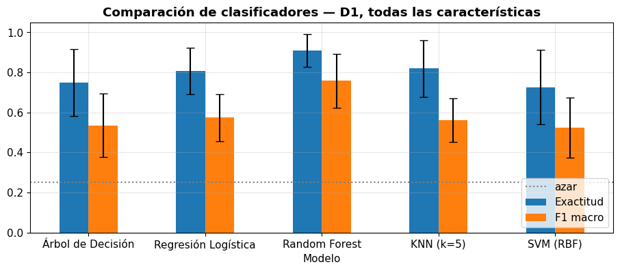 
  <em>Figura 11. Exactitud y F1 macro de los cinco clasificadores. Las barras negras son la variación entre pliegues.</em>

El mejor fue Random Forest, con F1 macro de 0.758, lo que coincide con el artículo base, donde también ganó Random Forest (con alrededor de 98 % de exactitud). La diferencia con el segundo (regresión logística, 0.574) es de 0.184, mayor que la variación de Random Forest entre pliegues (0.134). Aun así no es una diferencia totalmente segura, porque solo hay 16 bloques y la variación entre pliegues es grande en todos los modelos.

  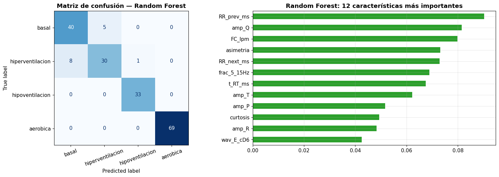 
  <em>Figura 12. Izquierda: matriz de confusión de Random Forest. Derecha: las 12 características más importantes.</em>

En la matriz de confusión, hipoventilación (33 de 33) y aeróbica (69 de 69) se clasificaron perfecto. Toda la confusión estuvo entre basal e hiperventilación: 5 latidos basales se predijeron como hiperventilación y 8 de hiperventilación como basal. Esto cuadra con lo que vimos en la FC y en los boxplots, donde esas dos condiciones casi se superponen.

Las características más importantes para Random Forest fueron RR previo, amp_Q, FC, asimetría y RR siguiente. Que tres de las cinco sean de ritmo era esperable. Lo que nos llamó la atención es que amp_Q quedó segunda, y creemos que es en parte por los dos problemas que explicamos antes: en DI la "Q" es en realidad la onda R original invertida, y en aeróbica la Q está distorsionada por el latido anterior, lo que la vuelve muy fácil de separar.

*¿El modelo solo está contando latidos por minuto?*

Como las condiciones se diferencian sobre todo por la FC, se repitió la comparación usando solo las 3 características de ritmo y usando solo las 21 de forma.

| Modelo | F1 con todas | F1 solo ritmo | F1 solo forma |
|---|---:|---:|---:|
| Árbol de decisión | 0.536 | 0.374 | 0.592 |
| Regresión logística | 0.574 | 0.296 | 0.594 |
| Random Forest | 0.758 | 0.356 | 0.692 |
| KNN (k = 5) | 0.561 | 0.323 | 0.528 |
| SVM (RBF) | 0.524 | 0.325 | 0.555 |

  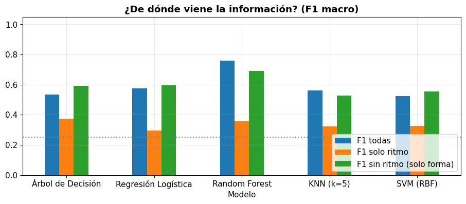 
  <em>Figura 13. F1 macro con todas las características, solo con ritmo y solo con forma.</em>

Al quitar el ritmo, el F1 de Random Forest bajó solo de 0.758 a 0.692, y en tres modelos incluso subió un poco. Solo con ritmo, en cambio, todos quedaron entre 0.30 y 0.37, apenas por encima del azar. Esto pasa porque con el ritmo solo se separa bien aeróbica, mientras que basal, hiperventilación e hipoventilación tienen FC parecidas. O sea que la forma del latido sí tiene información útil, aunque parte de ella puede venir de diferencias del propio registro (contacto de los electrodos, minutos de diferencia) y no solo de la fisiología.

Para ver el efecto de la fuga de datos, se evaluó Random Forest con solo forma mezclando los latidos al azar. Salió un F1 de 0.958, contra 0.692 con la validación por bloques. La diferencia es enorme (mucho más que en el laboratorio de EMG), porque latidos consecutivos del mismo registro son casi copias y el modelo los reconoce de memoria.

<u>**6. Cuestionario: experimentos con nuestros datos**</u>

El notebook tiene una función experimento() que repite toda la Parte B con los parámetros que uno elija. Con ella respondimos cinco preguntas.

*Pregunta 1: ¿qué derivación funciona mejor?*

El mejor F1 fue en DIII con regresión logística (0.797), seguido de DI con Random Forest (0.758) y muy por debajo DII con árbol de decisión (0.363). Esto no coincide con la calidad que vimos en la Parte A, porque DIII tenía los dos archivos más problemáticos. Creemos que DIII sale alta por razones que no tienen que ver con la fisiología de cada condición: en aeróbica la FC fue de 156 lpm porque se grabó apenas terminó el ejercicio, y en hiperventilación solo quedaron 12 latidos válidos. Por eso DI sigue siendo la más confiable.

El caso de DII también se explica con la FC: ahí basal, hipoventilación e hiperventilación salieron con 72.2, 72.1 y 80.0 lpm, así que casi no se diferencian por ritmo, y la forma del latido en esa derivación tampoco alcanzó para separarlas.

*Pregunta 2: ¿importa la polaridad?*

En DII no cambió nada al usar inversión automática o dejar la señal como estaba. Se detectaron los mismos latidos (39, 43, 39 y 73), amp_R promedio fue 0.717 mV y amp_S −0.254 mV en ambos casos, y el F1 se quedó en 0.363. Esto pasa porque DII ya tiene el QRS positivo y la inversión automática no la invierte, así que amp_R sí está midiendo la onda R real. La polaridad importa más en derivaciones como DI, donde al invertir cambia qué onda se mide como Q y cuál como R.

*Pregunta 3: ¿qué par de condiciones es más difícil?*

Usando solo ritmo, basal contra aeróbica dio un F1 de 1.000 en todos los modelos, mientras que basal contra hiperventilación llegó como máximo a 0.426. El par difícil es basal contra hiperventilación, porque sus FC y RR son casi iguales, mientras que la aeróbica tiene una FC muchísimo mayor.

*Pregunta 4: sensibilidad del detector*

Se cambió el factor del umbral en el archivo con más problemas, hiperventilación DIII:

| factor_umbral | Latidos detectados | Latidos válidos |
|---:|---:|---:|
| 0.1 | 48 | 41 |
| 0.3 | 28 | 12 |
| 0.7 | 3 | 1 |

Con 0.1 se recuperan los QRS que se perdían porque el artefacto había subido el umbral, y solo queda un 6.4 % de RR anómalos. Para este archivo elegiríamos 0.1, aunque igual habría que revisarlo visualmente por el artefacto del inicio. Un umbral tan bajo en un archivo limpio podría empezar a contar ondas T como latidos, así que no conviene usarlo para todos sin revisar.

*Pregunta 5: ¿cuántas características necesitamos?*

Con solo las 5 características más importantes del Random Forest (RR previo, amp_Q, FC, asimetría y RR siguiente), el mejor F1 bajó de 0.758 a 0.478. Baja bastante, así que en nuestro caso se pierde información útil. Usar menos características tendría la ventaja de ser más rápido de calcular, ocupar menos memoria y dar un modelo más simple, lo que sirve en un dispositivo portátil, pero aquí no compensa la pérdida de rendimiento.

<u>Discusión y conclusiones</u>

Varios resultados tuvieron sentido fisiológico: la FC subió claramente después del ejercicio y fue bajando durante el registro, fue la más baja al retener la respiración, y al aumentar la FC la onda T se acercó al pico R. El filtro de 0.5 a 40 Hz quitó la deriva y la interferencia sin deformar las ondas, y el algoritmo de Pan-Tompkins detectó bien los latidos en todos los archivos limpios.

Lo que más nos llamó la atención fue la importancia de revisar los datos antes de clasificar. El orden de grabación de las derivaciones explicó por qué la FC aeróbica fue de 156 lpm en DIII y de 128 lpm en DI, y por qué DIII dio el mejor F1 a pesar de ser la de peor calidad. Si no hubiéramos hecho la Parte A, habríamos elegido DIII y sacado conclusiones equivocadas.

También nos dimos cuenta de que las medidas morfológicas con ventanas fijas fallan cuando la FC es alta. En aeróbica la ventana de −200 ms llegó hasta la onda T del latido anterior, lo que infló la onda P y volvió positiva la onda Q. A esto se suma que en DI, al invertir la señal, la "Q" en realidad es la R original. Estas dos cosas probablemente ayudaron al clasificador a separar aeróbica, pero no por una razón fisiológica. Una mejora sería ajustar la ventana según el RR de cada latido.

Random Forest fue el mejor modelo, igual que en el artículo base, pero con un F1 de 0.758 y no de 0.98. La diferencia tiene sentido porque el artículo clasifica tipos de latido (normales y patológicos) de muchos pacientes, que tienen formas muy distintas, mientras que nosotros clasificamos condiciones fisiológicas de una misma persona sana, donde basal e hiperventilación casi no se diferencian. Además, con mezcla al azar habríamos obtenido 0.958, lo que muestra que la forma de validar puede cambiar completamente la conclusión.

Por último, hay que tomar los resultados con cuidado: es un solo participante, con unos 30 s por condición, así que el modelo aprende las condiciones de esta persona en esta sesión, y parte de lo que distingue a dos archivos puede ser el propio registro y no la fisiología.

<u>Preguntas para pensar</u>

*¿Qué cambiaría si los registros tuvieran varias personas?*

Habría que evaluar separando los datos por persona, para que el modelo nunca se pruebe con alguien que vio al entrenar. Probablemente el rendimiento bajaría, porque la forma del latido cambia mucho entre personas por la anatomía, la posición del corazón y la colocación de los electrodos. Las características de ritmo serían más fáciles de generalizar que las de forma.

*¿Cómo se podría usar más de una derivación?*

Lo ideal sería grabar las tres derivaciones al mismo tiempo, con un equipo de varios canales, y juntar las características de cada una en un solo vector. Así cada latido se describiría desde varios ángulos a la vez. Con el BITalino de un canal no se puede hacer, porque cada derivación es un momento distinto.

*¿Cómo se podría mejorar la medición de las ondas?*

Usando ventanas que se adapten al RR de cada latido en lugar de ventanas fijas, o un algoritmo de delineación que busque el inicio y el fin de cada onda, como los que usan los programas clínicos. También convendría elegir una derivación con QRS positivo para que los nombres de las ondas correspondan a lo anatómico.

<u>Referencias</u>

Pan, J. y Tompkins, W. J. (1985). A real-time QRS detection algorithm. IEEE Transactions on Biomedical Engineering, BME-32(3), 230-236.

PLUX. BITalino (r)evolution ECG Sensor Datasheet.

Sörnmo, L. y Laguna, P. (2005). Bioelectrical signal processing in cardiac and neurological applications. Elsevier.

Subba, T. y Chingtham, T. (2024). Comparative analysis of machine learning algorithms with advanced feature extraction for ECG signal classification. IEEE Access. https://doi.org/10.1109/ACCESS.2024.3387041
