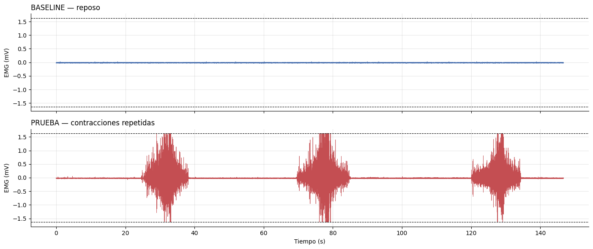
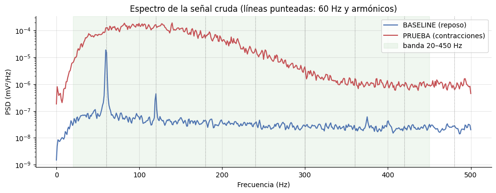
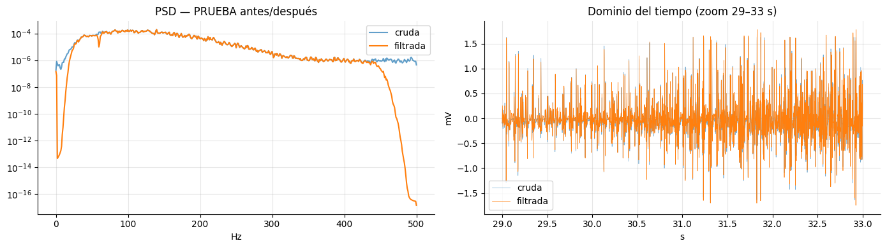
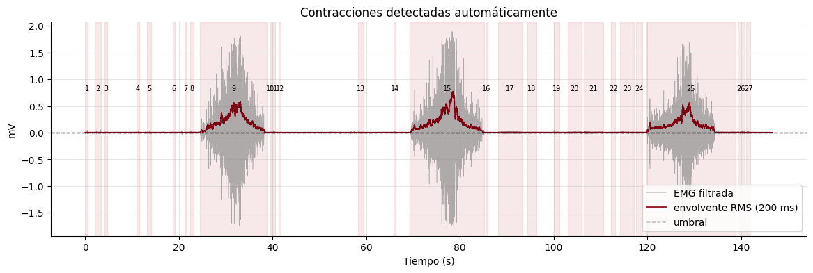
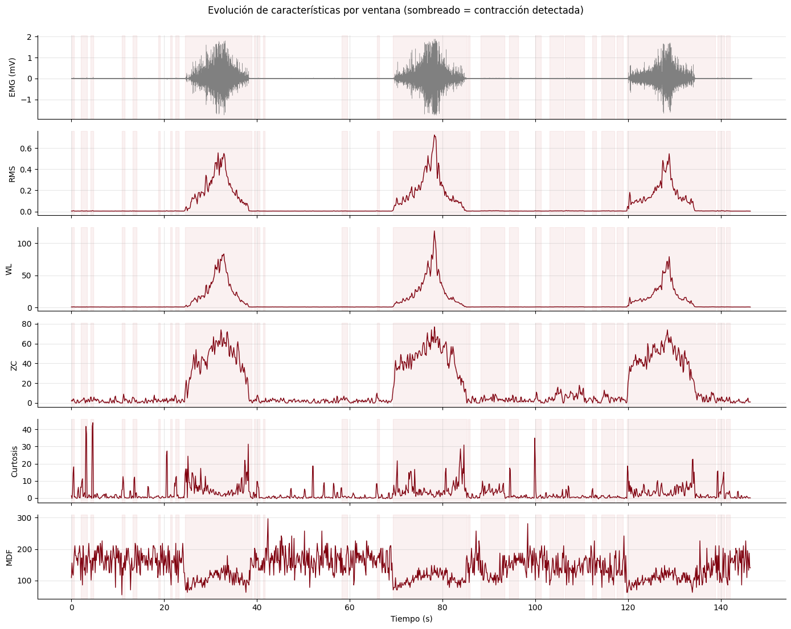
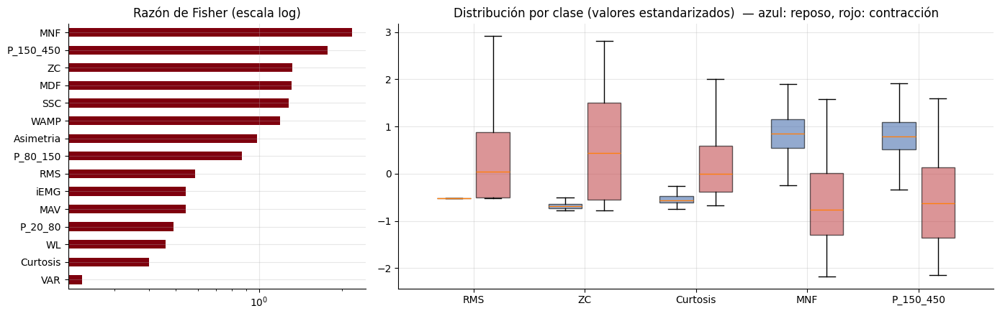
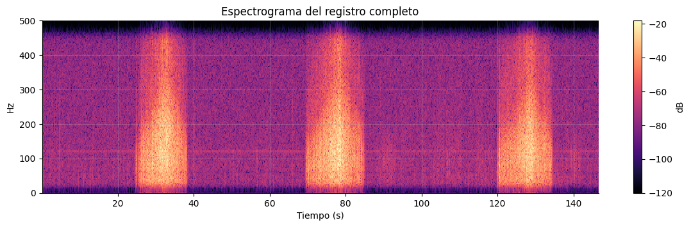
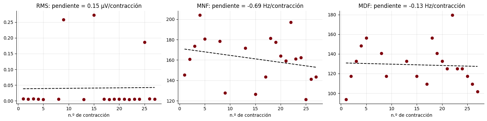

<u>**Informe de laboratorio 9: Extracción de características de la señal EMG**</u>

**Integrantes:** Julio Alonso Vásquez Tantaleán, Mariel Andrea Brachowicz Suarez, Abigail Alcazar Vargas, Ana Paula Vela Velasquez

<u>Resumen</u>

En este laboratorio trabajamos con el notebook que nos dio el profesor, *Laboratorio_10_EMG_GRUPO_2.ipynb*, que tiene todo el procedimiento para pasar de una señal EMG cruda a un conjunto de números (características) con los que una computadora puede decidir si un músculo está en reposo o contraído. En clase se fue revisando cada bloque de código y cómo leer las gráficas que salían.

En vez de usar los archivos de ejemplo del profesor, usamos nuestros propios registros del laboratorio de EMG (Laboratorio 3), tomados con el BITalino el 4 de septiembre:

- *movimiento_basal_m.txt*: el brazo en reposo, que sirve como referencia del ruido.
- *movimiento_leve_m.txt*: tres contracciones leves con descansos de unos 30 segundos entre cada una.

Al final del notebook se generó el archivo *caracteristicas_emg.csv*, que guarda todas las características calculadas.

<u>**1. Un poco de teoría: ¿de dónde sale la señal EMG?**</u>

Lo primero que se explicó en clase es que un músculo no se contrae "todo de golpe". Está dividido en **unidades motoras**, que son una neurona motora más todas las fibras musculares que controla. Cada vez que esa neurona dispara, sus fibras generan un pequeño pulso eléctrico llamado **MUAP** (potencial de acción de unidad motora).

El cuerpo controla la fuerza de dos maneras:

- **Reclutamiento:** activa más unidades motoras. Esto hace que la señal tenga más amplitud.
- **Frecuencia de disparo:** hace que cada unidad dispare más rápido.

Un electrodo puesto sobre la piel no ve una sola unidad motora, sino la suma de muchas a la vez. Por eso la EMG de superficie parece ruido, pero su **amplitud** y sus **frecuencias** sí tienen información sobre lo que hace el músculo. El notebook lo mostró con una simulación: con 1 unidad motora se ven picos separados, y con 60 ya no se distingue ningún pico y la señal se ve como ruido, pero con mucha más amplitud.

Los valores típicos que se mencionaron fueron: amplitud de microvoltios a pocos milivoltios, banda útil de unos 20 a 450 Hz y la mayor parte de la energía entre 50 y 150 Hz.

<u>**2. Adquisición y lectura de nuestros datos**</u>

*Lectura del archivo*

El notebook trae su propia función para leer los archivos de OpenSignals. Lee la cabecera del archivo para sacar la frecuencia de muestreo y la resolución, en vez de suponerlas. Nuestros dos registros salieron con **1000 Hz**, **10 bits** (valores de 0 a 1023) y una duración de **146.7 s** cada uno.

*Conversión a milivoltios*

Con la fórmula de la hoja técnica del sensor EMG del BITalino (VCC = 3.3 V y ganancia de 1009) pasamos los valores del ADC a milivoltios. Con esto, el sensor puede medir como máximo **±1.632 mV**, y el cambio más pequeño que distingue es de **3.19 µV**.

   
  <em>Figura 1. Arriba el registro en reposo y abajo el registro con las contracciones. Las líneas punteadas marcan el límite que puede medir el sensor.</em>

En la Figura 1 se ve muy claro lo que hicimos en el Laboratorio 3: el reposo es casi una línea plana y en la prueba aparecen las **tres contracciones**, más o menos entre los segundos 25 y 38, 70 y 85, y 120 y 134.

*Saturación*

En las tres contracciones la señal llega a tocar las líneas punteadas, o sea que el sensor se **saturó**: la señal real era más grande de lo que el BITalino podía medir y se quedó "pegada" en el máximo. Con el criterio del notebook (valores de 0 o 1023) salieron **41 muestras saturadas (0.028 %)**. Revisando mejor, el valor donde realmente se pegaba la señal por arriba era 1022, y contándolo salen **141 muestras (0.096 %)**, que afectan a 51 ventanas.

Parece poco, pero no está repartido al azar: pasa justo en los momentos de más fuerza. Algo que se remarcó en clase es que la saturación **no se puede arreglar con ningún filtro**, hay que evitarla al momento de grabar.

<u>**3. Preprocesamiento (filtrado)**</u>

*Espectro antes de filtrar*

Antes de filtrar se miró el espectro de la señal con el **método de Welch**, que divide la señal en pedazos, calcula la FFT de cada uno y los promedia. Así sale un espectro más estable que con una sola FFT.

   
  <em>Figura 2. Espectro de la señal cruda. Azul: reposo. Rojo: contracciones.</em>

En el reposo (azul) se ve un pico muy marcado en **60 Hz** y otro en **120 Hz**. Es la interferencia de la corriente eléctrica. En la prueba (roja) la potencia es entre 100 y 10 000 veces mayor y tiene su máximo más o menos entre 80 y 130 Hz, que es la forma típica de una EMG. Ahí casi no se nota el pico de 60 Hz porque la actividad del músculo lo tapa.

*Filtros usados*

Se usaron dos filtros:

1. Un **pasa-banda Butterworth de 20 a 450 Hz** (orden 4), que quita la deriva lenta, los artefactos de movimiento y el ruido de alta frecuencia.
2. Un **notch en 60 Hz** (Q = 30), que quita solo la interferencia de la red eléctrica.

Los dos se aplicaron "hacia adelante y hacia atrás" (*filtfilt*) para no desfasar la señal. Esto sirve porque estamos analizando la señal después de grabarla. Una prótesis en tiempo real no podría hacerlo así.

   
  <em>Figura 3. Izquierda: espectro antes y después de filtrar. Derecha: un pedazo de la señal entre 29 y 33 s.</em>

Dentro de la banda de 20 a 450 Hz las dos curvas son casi iguales, o sea que el filtro no deformó la parte útil. En el tiempo, la señal filtrada y la cruda casi se superponen, lo que quiere decir que casi toda la energía ya estaba dentro de la banda útil. En el reposo, el pico de 60 Hz pasó de ser **233 veces** más grande que sus vecinas a solo **3.3 veces**.

*Relación señal-ruido*

Tomando el reposo como el "ruido" del sistema:

- RMS del reposo filtrado: **4.21 µV**
- RMS de la prueba filtrada: **137.57 µV**
- SNR aproximada: **30.3 dB**

Es decir, la señal del músculo tiene mucha más potencia que el ruido del equipo.

Además, mirando solo los tramos de contracción, el pico del espectro quedó en **140 Hz** y la frecuencia mediana en **118 Hz**. El 71 % de la potencia estaba entre 20 y 150 Hz, lo que coincide con la teoría. Solo el 6.6 % estaba por debajo de 50 Hz, así que un filtro pasa-bajos de 50 Hz habría borrado casi toda la señal del músculo.

<u>**4. Segmentación y etiquetado**</u>

*Detección de las contracciones*

Para encontrar dónde había contracción se calculó la **envolvente RMS** (una curva suave que sigue la amplitud de la señal, con ventanas de 200 ms) y se comparó con un **umbral**: el promedio del reposo más 5 desviaciones estándar.

Primero se probó con el umbral sacado del archivo de reposo (**6.7 µV**), y el 31.6 % de la prueba quedó marcado como activo. Luego se probó tomando el reposo dentro de la misma prueba (el 20 % de la señal con menor amplitud), y el umbral bajó a **4.4 µV**. La idea que se explicó en clase es que el reposo de referencia debe tomarse en las mismas condiciones que la señal que se analiza.

   
  <em>Figura 4. Contracciones detectadas automáticamente (franjas rosadas numeradas).</em>

Con ese umbral el código detectó **27 segmentos de actividad**. Pero en la Figura 4 se ve que en realidad hay **solo 3 contracciones**. El umbral quedó tan bajo que pequeñas fluctuaciones del reposo también se contaron como "contracción" (por ejemplo, los segmentos 1 al 8 o del 16 al 24). Esto es importante porque afecta a varios resultados de más adelante.

*Ventanas*

Después la señal se cortó en **ventanas de 250 ms** con 50 % de solapamiento (una ventana nueva cada 125 ms). Se usan ventanas cortas porque la EMG cambia con el tiempo. A cada ventana se le puso una etiqueta según cuánto de ella caía dentro de una contracción detectada:

- **Reposo:** 475 ventanas
- **Contracción:** 623 ventanas
- **Transición:** 74 ventanas (no se usan para entrenar porque su etiqueta es dudosa)

En total fueron **1172 ventanas**, y 29 de ellas tenían alguna muestra saturada.

<u>**5. Extracción de características**</u>

Una característica es básicamente una fórmula que convierte una ventana de 250 muestras en un solo número que tenga sentido. Se calcularon 15, separadas en cuatro grupos:

- *De amplitud:* MAV, RMS, iEMG y VAR. Dicen cuánta actividad hay.
- *De forma de onda:* WL, ZC (cruces por cero), SSC (cambios de pendiente) y WAMP. Dicen qué tan rápido y cuánto cambia la señal. ZC, SSC y WAMP usan un umbral de ruido de **12.6 µV** para no contar fluctuaciones pequeñas.
- *Estadísticas:* asimetría y curtosis. Dicen si la distribución de amplitudes se parece a una campana de Gauss.
- *De frecuencia:* MNF (frecuencia media), MDF (frecuencia mediana) y la proporción de potencia en las bandas de 20 a 80, 80 a 150 y 150 a 450 Hz.

Comparando los promedios de cada clase:

- El **RMS** fue de 0.0040 mV en reposo y 0.1174 mV en contracción, unas **29 veces más**.
- **ZC** pasó de 1.9 a 28.0 y **WAMP** de 2.2 a 105.2.
- La **MDF** bajó de 168 Hz a 118.5 Hz, y la **MNF** de 193.5 Hz a 135.5 Hz. En reposo la "señal" es casi solo ruido, que se reparte en todas las frecuencias, mientras que la contracción concentra su energía alrededor de 100 a 150 Hz.

   
  <em>Figura 5. Cómo cambian algunas características a lo largo del registro.</em>

En la Figura 5 se ve que **RMS y WL** son las curvas más limpias: suben claramente en cada una de las 3 contracciones y casi no se mueven en el reposo. ZC también sube, pero es más irregular. La **curtosis** es muy ruidosa y la **MDF** varía bastante entre ventanas.

*¿Qué característica separa mejor?*

Para medirlo se usó la **razón de Fisher**, que compara qué tan lejos están los promedios de las dos clases con respecto a qué tan dispersas están. Mientras más alta, mejor separa.

   
  <em>Figura 6. Razón de Fisher de cada característica (izquierda) y distribución por clase (derecha).</em>

Las que mejor separaron fueron **MNF (2.18)**, **P_150_450 (1.77)** y **ZC (1.32)**. El RMS quedó bastante abajo (0.59), cosa que al inicio nos pareció rara porque en la Figura 5 se ve muy limpio. La explicación está en el boxplot: la caja roja del RMS empieza al mismo nivel que el reposo. Eso pasa porque muchas ventanas etiquetadas como "contracción" en realidad son de los segmentos falsos de la Figura 4, que tienen amplitud de reposo. Esto hace que el RMS de la clase contracción esté muy disperso y Fisher lo castigue.

Otras cosas que salieron:

- **MAV, RMS, iEMG, VAR y WL son casi redundantes:** su correlación entre sí fue de 0.925 a 1.000. MAV e iEMG dan exactamente lo mismo porque iEMG es MAV multiplicado por el número de muestras.
- **La saturación baja la curtosis:** en las ventanas de contracción sin saturación la curtosis promedio fue 4.41, y en las saturadas 2.42. Tiene sentido, porque al recortar los picos se pierden los valores extremos.

<u>**6. Clasificación con LDA y SVM**</u>

Con las características se entrenaron dos clasificadores para que decidan si una ventana es reposo o contracción:

- **LDA** (análisis discriminante lineal), que es el más usado en control de prótesis por ser rápido y simple.
- **SVM** con kernel RBF, que puede hacer fronteras no lineales.

Algo que se explicó mucho en clase fue la **fuga de datos**. Como las ventanas se solapan un 50 %, dos ventanas vecinas comparten la mitad de sus muestras. Si una cae en entrenamiento y la otra en prueba, el modelo "hace trampa". Para evitarlo se usó **GroupKFold**, que manda cada ciclo completo (reposo + contracción) solo a entrenamiento o solo a prueba. Como medida se usó la **exactitud balanceada**, donde 0.5 es adivinar al azar y 1.0 es acertar todo.

Resultados:

- Con las 15 características: **LDA 0.861** y **SVM 0.857**.
- Solo con RMS: LDA 0.704 y SVM 0.712.
- Sin las de amplitud: LDA 0.818 y SVM 0.833.
- **Un solo umbral en el RMS** (un árbol de decisión de un nivel): **0.914**, el mejor de todos.

En la matriz de confusión del LDA, de 475 ventanas de reposo acertó 447 y de 623 de contracción acertó 523. El error más común fue confundir contracción con reposo, lo cual cuadra con los segmentos falsos que mencionamos.

Para ver el efecto de la fuga, se comparó un KFold normal (mezclando todo al azar) con GroupKFold: salió **0.869 contra 0.833**. Con KFold normal el resultado sale un poco inflado.

<u>**7. Deep learning: espectrograma y CNN**</u>

La última parte fue la diferencia entre características **diseñadas** por nosotros (RMS, MDF, etc.) y características **aprendidas** por una red neuronal.

Para esto se usó la **STFT** (transformada de Fourier de tiempo corto), que calcula la FFT en ventanitas que se van moviendo. El resultado es el **espectrograma**, una especie de imagen de tiempo contra frecuencia. Como las CNN son buenas reconociendo patrones en imágenes, se le pasaron estos espectrogramas.

   
  <em>Figura 7. Espectrograma de todo el registro.</em>

En el espectrograma se ven 3 franjas brillantes, una por cada contracción, más intensas en las frecuencias bajas.

Se usaron ventanas de 500 ms, lo que dio **503 imágenes** (212 de reposo y 291 de contracción). La red era chiquita, con **1330 parámetros**, y se evaluó con la misma división por grupos. Obtuvo **0.852 ± 0.084**, prácticamente igual que el LDA y la SVM, y por debajo del umbral simple en RMS. La curva de pérdida bajó, pero con saltos bruscos, así que el entrenamiento fue algo inestable.

Además se mostraron los mapas de la primera capa de la red. Cada filtro aprendió a fijarse en una zona distinta del espectrograma, pero no tienen un significado fisiológico claro como el RMS o la MDF. Eso es lo que se pierde en interpretabilidad con el deep learning.

<u>**8. Ejercicios**</u>

*Ejercicio 1: tamaño de ventana*

Se repitió todo con ventanas de 100, 250 y 500 ms. Al usar ventanas más largas, la razón de Fisher subió en RMS (0.54 → 0.67), ZC (1.20 → 1.55) y sobre todo en **MDF (0.76 → 2.87)**, porque para estimar bien un espectro hacen falta más muestras. La curtosis se mantuvo baja en los tres casos (0.36 a 0.40). El costo de la ventana larga es que hay menos ventanas (de 2850 a 503) y el sistema decide más lento.

Un LDA con solo las 3 mejores según Fisher (MNF, P_150_450 y ZC) dio **0.812**, menos que con las 15 juntas. O sea, que una característica sea la mejor por sí sola no significa que sea la mejor combinación. Al quitar las ventanas saturadas el resultado casi no cambió (0.819 y 0.817), pero la curtosis promedio de la contracción subió de 4.32 a 4.46.

*Ejercicio 2: ¿hubo fatiga?*

   
  <em>Figura 8. RMS, MNF y MDF de cada segmento detectado.</em>

Si hubiera fatiga, la MDF y la MNF deberían bajar y el RMS debería subir con cada contracción. La MNF y la MDF tuvieron pendientes un poco negativas, pero **ningún resultado fue significativo** (todos con p > 0.05), así que **no encontramos evidencia de fatiga**.

Igual, este resultado hay que tomarlo con cuidado. En la gráfica del RMS se ve que solo 3 puntos son contracciones de verdad (los que están arriba, entre 0.19 y 0.27 mV) y los otros 17 son segmentos de reposo que se colaron. Con solo 3 contracciones leves, separadas por 30 segundos de descanso, es difícil que aparezca fatiga, y además la fuerza no estuvo controlada y hubo saturación.

<u>Discusión y conclusiones</u>

Los resultados con nuestros datos tuvieron sentido con la teoría en varias cosas: la energía de la contracción se concentró entre 20 y 150 Hz, el filtro quitó bien la interferencia de 60 Hz sin dañar la señal útil, la SNR fue alta (30.3 dB) y en la contracción la amplitud fue unas 29 veces mayor que en reposo.

Lo que más nos llamó la atención fue que **un solo umbral en el RMS (0.914) funcionó mejor que el LDA, la SVM y la CNN**. Para una tarea tan sencilla como reposo contra contracción, no hace falta algo complicado. Los vectores con muchas características y las redes neuronales sirven más para cosas difíciles, como distinguir entre distintos gestos de la mano, donde todos los gestos son contracción y la amplitud sola no alcanza.

También nos dimos cuenta de que la detección automática de contracciones es clave. Al quedar el umbral tan bajo, se detectaron 27 segmentos cuando en realidad hicimos 3 contracciones. Eso probablemente explica por qué el RMS salió tan abajo en el ranking de Fisher, por qué el LDA confundió tantas contracciones con reposo y por qué el análisis de fatiga no es muy confiable. Subir el umbral o usar el del archivo de reposo podría dar resultados más limpios.

Por último, tuvimos saturación en las tres contracciones. Para la próxima convendría hacer contracciones más suaves o revisar la colocación de los electrodos, porque eso no se arregla después con ningún procesamiento.

En general, el laboratorio nos ayudó a entender todo el camino que sigue un dispositivo como una prótesis mioeléctrica: grabar la señal, limpiarla, cortarla en ventanas, resumirla en números y tomar una decisión con esos números.

<u>Preguntas para pensar</u>

*¿Qué características usarían para una prótesis que tiene que decidir en menos de 300 ms?*
Ventanas de 100 a 250 ms con características rápidas de calcular, como RMS, WL y ZC. En nuestros datos el RMS solo ya funcionó muy bien para reposo contra contracción. Las de frecuencia (MNF, MDF) ayudan, pero necesitan ventanas más largas para ser confiables.

*¿Cómo cambiaría el análisis con varios canales (varios músculos)?*
Se sacarían las mismas características de cada canal y se juntarían en un solo vector. Así se podrían reconocer movimientos distintos según qué músculos se activan y cuánto, aunque habría más datos que procesar.

*¿Qué haría falta para que el modelo funcione en otra persona?*
Grabar a varias personas y evaluar separando los datos por sujeto. La amplitud y el espectro de la EMG cambian según la anatomía, la grasa y la posición de los electrodos, así que probablemente también haría falta calibrar el modelo con un poco de datos de cada persona nueva.

<u>Referencias</u>

- De Luca, C. J. (1997). The use of surface electromyography in biomechanics. Journal of Applied Biomechanics, 13(2), 135-163.
- Hermens, H. J., Freriks, B., Disselhorst-Klug, C. y Rau, G. (2000). Development of recommendations for SEMG sensors and sensor placement procedures (SENIAM). Journal of Electromyography and Kinesiology, 10(5), 361-374.
- Hudgins, B., Parker, P. y Scott, R. N. (1993). A new strategy for multifunction myoelectric control. IEEE Transactions on Biomedical Engineering, 40(1), 82-94.
- Phinyomark, A., Phukpattaranont, P. y Limsakul, C. (2012). Feature reduction and selection for EMG signal classification. Expert Systems with Applications, 39(8), 7420-7431.
- PLUX. BITalino (r)evolution EMG Sensor Datasheet.
